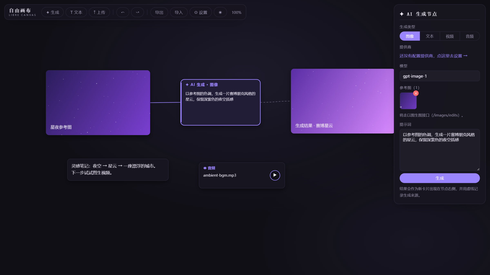
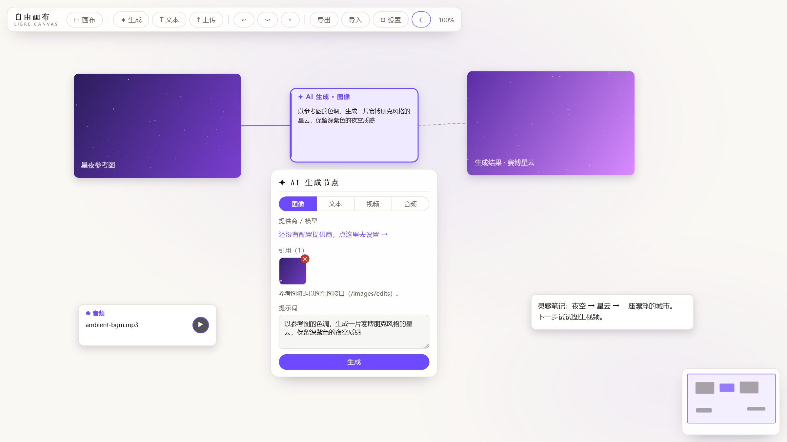

# LibreCanvas 自由画布

**开源、免费、BYOK 的 AI 创作画布。自己的 key，自己的画布。**

AI 画布平台一个接一个涨价、锁功能、圈订阅。LibreCanvas 反着来：

- **真开源**：MIT 许可证，没有"公开但不许改"，没有商业授权二重门。随便 fork，随便自部署，随便商用。
- **BYOK（Bring Your Own Key）**：你自己去模型提供商充值买 API，key 只存在你本机浏览器的 localStorage 里，调用时浏览器直连提供商接口——本项目没有服务器，也永远见不到你的 key。
- **多模型**：任何 OpenAI 兼容接口都能接（OpenAI、DeepSeek、硅基流动、智谱、各类中转站……），文生图、文生文自由切换。
- **零成本部署**：纯静态站点，GitHub Pages / 任何静态托管 / 本地打开都能跑。

## 功能（v1.6）

- 无限画布：滚轮缩放、空格+拖拽平移、左键框选、Shift 多选、整体拖动、对齐吸附辅助线、复制/粘贴/副本、右键菜单、适应画布、Ctrl+G 编组、Ctrl+Z 撤销重做
- 多画布项目：工具栏「▤ 画布」新建/切换/重命名/删除，每块画布独立保存、切换自动落盘
- `@` 引用：生成节点提示词里敲 `@` 弹出卡片菜单——文本卡并入提示词作引用资料，图片卡直接成为参考图
- **结果迭代开分支**：图片/文本卡一键「✦ 迭代」——以该卡为参考新建生成节点（继承上游提供商/模型），原结果永不覆盖，血缘树自然生长
- 小地图：右下角内容缩影 + 视口框，点击/拖拽快速跳转
- 昼/夜双皮肤：与主站同源的设计 token，画布内卡片与连线同步换色，偏好本地记忆
- 五类卡片：图片、视频（画布内播放）、音频（播放键）、文本（双击编辑）、AI 生成节点（双击画布创建）
- 四种生成：文生图（/images/generations）、文生文（/chat/completions）、文生视频（自动轮询进度）、文本转语音（/audio/speech，可选音色）
- **多提供商视频适配**：OpenAI `/videos` 之外，按 Base URL 自动切换火山方舟 Seedance（`/contents/generations/tasks`，支持图/视频/音频多模态参考素材）与硅基流动（`/video/submit`，带参考图时自动改用 I2V 模型）
- **模型下拉实拉**：模型选择器直接 `GET /models` 拉取账号真实可用的模型（硅基流动按节点模式自动带 `?type=`），输入框兼作搜索框，不用再手记模型名
- 全类型上传：图片 / 视频 / 音频 / 文本（.txt/.md），工具栏「上传」或直接拖入画布，坏文件超时跳过不阻塞
- **图片参考输入**：悬停图片卡从右侧锚点拖线连到生成节点即成参考（紫色实线）。图像模式自动走以图生图（/images/edits，支持多图）；文本模式把图片作为视觉输入发给多模态模型；面板内缩略图可单个移除
- **蒙版局部重绘（inpainting）**：选中图片 → 「局部重绘」→ 画笔涂抹目标区域（可调笔刷/擦除/清空）→ 提示词生成。走 /images/edits 的 image+mask 规范（涂抹区 alpha 精确归零），结果落新卡带血缘线
- 生成血缘：生成结果作为新卡片出现在节点右侧，虚线记录来源
- 画布自动保存到浏览器 IndexedDB（大媒体也装得下），支持导出/导入 JSON
- 提供商管理：多提供商、常用模型下拉、连接测试、内置常见预设
- **本地 ComfyUI（MiniMax H3）**：把本机 ComfyUI 当成一个「提供商」接进画布——图片卡拖线当首帧、写提示词、选一档 H3 预设，就能在画布里跑本地图生视频，成片带 **H3 原生音轨**落成视频卡，可以直接在画布里播放、迭代分支。8GB 卡也能跑（960×544 / 158 帧 / 20 步）。

## 在线使用

官方部署：<https://canvas.tiaozhuxiansheng.com>（纯静态，你的 key 只存你自己的浏览器）

## 界面

设计语言与 [蛛网之上](https://tiaozhuxiansheng.com) 同源：暖白纸面 / 夜幕双皮肤，蛛丝紫点睛，一键切换。

**夜屏（默认）** —— 参考图连线 → 生成节点 → 结果落卡，虚线记录生成血缘：



**昼屏** —— 同一块画布，暖白纸面：



## 接本地 ComfyUI（MiniMax H3）

画布可以直接驱动本机的 ComfyUI 跑 H3 图生视频，不需要在 ComfyUI 里拖一百个节点。

1. 先把 ComfyUI 起起来（本机示例，8GB 显存的低显存档）：

   ```bat
   cd /d C:\ComfyUI-H3\ComfyUI_windows_portable
   python_embeded\python.exe -s ComfyUI\main.py --windows-standalone-build --lowvram --async-offload --reserve-vram 0.6
   ```

   > 首帧是通过 ComfyUI 的 `/upload/image` 传进它 input 目录的；工作流由画布按 H3 的 W4A8 配方现拼。

2. 画布：右上角「⚙ 设置」→ 点「**本地 ComfyUI（H3）**」预设 → 地址默认 `http://127.0.0.1:8188` → 「测试连接」应显示 ComfyUI 版本与显存。

3. 双击画布建生成节点 → 模式选「视频」→ 提供商选「本地 ComfyUI」→ 模型下拉里选一档 H3 预设：

   | 预设 | 规格 | 大概耗时 |
   |---|---|---|
   | 横屏 960×544 · 6.6s · 20步 | 带音轨，交付档 | 约 15 分钟 |
   | 竖屏 544×960 · 6.6s · 20步 | 带音轨，竖屏交付 | 约 15 分钟 |
   | 横屏草稿 864×480 · 3s · 10步 | 无音轨，试构图 | 约 5 分钟 |
   | 竖屏草稿 480×864 · 3s · 10步 | 无音轨，试构图 | 约 5 分钟 |

4. 把一张图片卡右侧的圆点拖到生成节点上（这就是 i2v 的首帧），写提示词，点「生成」。

产物会作为视频卡落在节点右侧，带 H3 原生音轨，画布内可直接播放。

**开发模式为什么不用配 CORS**：浏览器不能直连 ComfyUI（它默认不放跨域头），所以开发模式统一走 dev server 的 `/__comfy` 反向代理，前端当同源用。打包成静态站点后是直连，需要给 ComfyUI 加 `--enable-cors-header`；服务不在本机时用环境变量 `LIBRE_COMFY=http://host:8188 npm run dev` 改代理目标。

**边界**：浏览器只做「生成 + 播放」。1080p 超分、补帧、成片质检这些重活不在画布里跑——用本机产线脚本（`minimax_h3_tool/scripts`）离线做，见那份产线文档。

### 出 1080p 母版（画布内一键）

生成出来的是 24fps 原片。要 1080p / 60fps，右键视频卡：

- **✦ 出 1080p 母版（超分+补帧）** → 1920×1080@60
- **✦ 出 1080p / 24fps 母版** → 只超分，保留电影感

它走本机一个很小的后处理桥：

```bash
npm run post:bridge        # 默认 http://127.0.0.1:8791
```

桥收到视频二进制后调用 `post_1080p60.py`（Real-ESRGAN ×4 + RIFE 2.5× + 编码），把成片吐回来，
画布左下角有任务面板显示阶段与已用时间；结果作为新卡落在原卡右侧，并拉一条血缘线。

> 进度是**阶段级**的（拆帧 → 超分 → 补帧 → 编码 + 已用分钟数），不是逐帧百分比：
> ncnn 的百分比是按图片循环重置的，拿来当总进度会骗人。单镜通常 1~6 分钟（看分辨率和帧数）。

### 质检门禁（出片即检）

后处理完成后**自动跑一次成片质检**，结果显示在卡片右上角：

| 徽标 | 含义 |
|---|---|
| 绿 ✓ | 通过，无提示 |
| 绿 ⚠N | 通过，但有 N 条提示（中途黑场、接近削波、moov 在后等） |
| 红 ✕ | 不通过（首帧黑屏、冻帧 ≥1s、整段静音、分辨率/帧率不符…） |

选中视频卡后，浮动条上还有一个「⌕ 质检」按钮，鼠标悬停能看到完整的失败/提示清单。
手动重检、或对没跑过后处理的卡质检，都点它。

判据与产线脚本一致（`quality_check.py`）：

- **fail**：首帧黑屏、冻帧 ≥1s、整段静音（≤ −60dB）、分辨率/帧率/时长不符、缺音轨（声明需要时）
- **warn**：中途黑场、接近削波（≥ −0.1dBFS）、声道数不符、`pix_fmt` 不是 yuv420p、`moov` 在 `mdat` 之后

> 画布不知道"这一镜该不该有声音"，所以默认按 `audio=any` 检：有音轨就查静音/削波，没有也不判失败。
> 要严格按分镜清单强制音轨，用产线脚本那边跑（shotlist 里的 `audio` 字段）。

### 批量

框选多张视频卡 → 右键（点卡上或空白处都行）：

- **✦ 批量出 1080p 母版（N 张）** —— 按画布顺序**串行**跑（同一张卡不能并发，会互相抢显存），
  每张出片后自动质检，左下角任务面板显示「第 3/8 张：shot03 · 补帧 60%」
- **⌕ 批量质检（N 张）** —— 只检不出片，用来复检一批已完成的卡。**只做结构检查**（黑屏/冻帧/静音/削波/手机兼容），不判分辨率与帧率——手动质检多半是查原片，拿 1080p60 的规格去卡它只会误报

跑完汇总成一条：

```
完成 6/8，2 张有问题：shot04（首帧黑屏（0.08s）——封面会黑），shot07（冻帧 1.20s @2.10s）等
```

有问题的会在面板里留 30 秒（没问题的 10 秒后自动消失），每张卡的右上角也各自挂着徽标，
所以哪张红了一眼就能找到。串行是故意的：8GB 卡上并行只会两边都慢，还会偶发 OOM。

## 快速开始

```bash
npm install
npm run dev
```

打开 http://localhost:5173 → 右上角「⚙ 设置」→ 添加提供商（填 Base URL 和 API Key）→ 双击画布创建生成节点 → 填提示词 → 生成。

### 操作速查

| 操作 | 说明 |
| --- | --- |
| 双击画布 | 创建 AI 生成节点（自动聚焦提示词框） |
| 双击生成节点 | 聚焦提示词框 |
| 左键拖拽（空白处） | 框选 |
| 空格 + 拖拽 / 滚轮 | 平移 / 缩放 |
| Shift + 点选 | 加选 / 减选 |
| 拖动选中节点 | 多选整体移动 |
| Ctrl+G / Ctrl+Shift+G | 编组 / 解组（点任一成员即全组选中） |
| Ctrl+A / Esc / Delete | 全选 / 取消选择 / 删除 |
| Ctrl+C / Ctrl+V / Ctrl+D | 复制 / 粘贴 / 创建副本（连内部连线一起，跨画布可贴） |
| Ctrl+Z / Ctrl+Shift+Z | 撤销 / 重做 |
| F | 适应画布（缩放到刚好装下全部内容） |
| 右键 | 上下文菜单（节点操作 / 粘贴到此处 / 新建） |
| 卡片右侧圆点拖线 | 连到生成节点作参考 |
| 提示词内输入 `@` | 引用画布上的图片 / 文本卡片 |

## 常见问题

**Q：数据存在哪？是"纯本地"吗？**
A：API Key 和提供商配置存浏览器 `localStorage`，画布内容（含图片/视频等媒体）存浏览器 `IndexedDB`。"纯本地"指数据**从不上传**（平台没有服务器可传）；物理上它在浏览器的站点数据里，换浏览器/换电脑不互通。

**Q：清理浏览器缓存会清空数据吗？**
A：只清"缓存的图片和文件"不影响；但勾选"**Cookie 和其他网站数据**"会把画布和 Key 一起清掉，无痕窗口关闭即清。**重要画布请用工具栏「导出」存成 JSON 文件备份**（「导入」可恢复；出于安全，Key 不进导出文件，需重新填写）。

## 已知边界

- 浏览器直连要求提供商接口支持 CORS。多数中转站都支持；但**官方 OpenAI 等接口不返回跨域头，浏览器直连会被拦**（表现为「Failed to fetch」或长时间卡死）。本地开发时可在「模型提供商设置」里勾选**「通过本地代理转发」**——请求经本机 dev server 中转再发往提供商，绕开跨域限制（Key 仍只在本机、不上传外部服务器）。该开关仅 `npm run dev` 生效，打包部署的静态版本无此中转，仍受提供商 CORS 策略约束。
- 视频生成默认走 OpenAI `/videos` 异步任务流（兼容返回 `data[0].url / b64_json` 的同步风格）；另按 Base URL 自动适配火山方舟（`/contents/generations/tasks`）与硅基流动（`/video/submit`）。其它私有协议暂不支持。
- 视频参考素材（图 + 视频 + 音频多模态）目前只有火山方舟 Seedance 全支持；硅基流动仅取首张图作 I2V 首帧。
- 单个上传文件上限 100MB。

## 路线图

- [x] 参考图用于视频生成（火山方舟 Seedance 图/视频/音频参考、硅基流动 I2V 首帧）
- [x] 非 OpenAI 兼容接口的原生适配（火山方舟、硅基流动）～ Anthropic 待办
- [ ] 模型列表按能力自动分类（当前依赖提供商的 type 参数）
- [x] 可选本地代理（解决官方 OpenAI 等接口的 CORS 限制，仅开发模式）
- [ ] 大画布性能优化（图片懒加载、视口裁剪渲染）
- [ ] 导出画布为长图

## 许可证

[MIT](./LICENSE) —— 用、改、卖，都行。唯一的请求：保持开源精神，别把它变成下一个收费围城。
